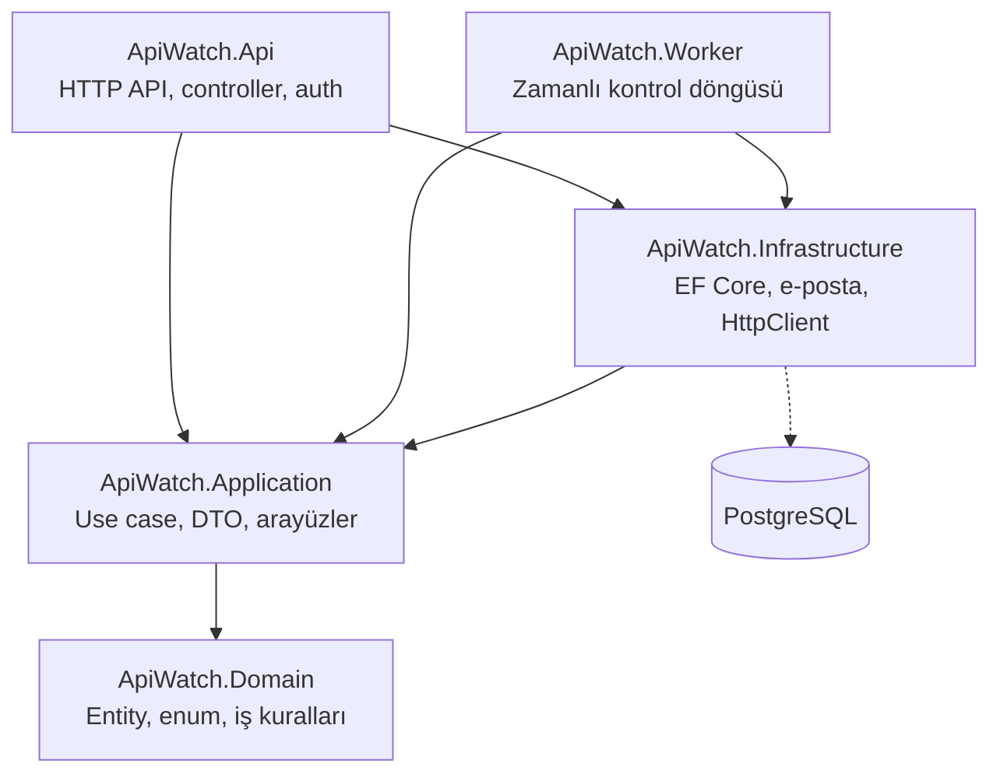

# APIWatch

**Küçük ekipler için API güvenilirlik ve iş akışı izleme platformu.**
ASP.NET Core (.NET 10) · PostgreSQL · EF Core · Clean Architecture · Docker

> 🚧 **Durum:** Aktif geliştirme aşamasında. Backend'i adım adım, her teknik kararı belgeleyerek geliştiriyorum. Tamamlanan ve planlanan işler [Yol haritası](#yol-haritası) bölümünde.

---

## Neden APIWatch?

Bir API'nin `200 OK` dönmesi, iş akışının doğru çalıştığı anlamına gelmez. Ürün fiyatı `0` dönüyor olabilir, yanıt 5 saniye sürüyor olabilir ya da beklenen alan hiç gelmeyebilir. Basit uptime araçları bunu yakalamaz. Datadog gibi kapsamlı platformlar ise küçük ekipler için fazla karmaşık ve pahalıdır.

APIWatch bu boşluğu hedefler:

- API uçlarını belirlenen aralıklarla otomatik olarak çağırır.
- Sadece status kodunu değil, **yanıt süresini** ve **JSON içeriğini** de kontrol eder. Örnek kural: `$.data.price > 0`.
- Üst üste başarısız kontroller olunca **olay (incident)** açar ve e-posta ile bildirir, sorun düzelince haber verir.
- Çok kiracılıdır (multi-tenant): her organizasyon yalnızca kendi verisini görür.

**Örnek senaryo:** `https://site.com/api/products/42` adresini 5 dakikada bir çağır. Status `200` olsun, süre `800 ms` altında kalsın, `$.data.price` sıfırdan büyük olsun. Üst üste 3 kez başarısız olursa ekibe e-posta gönder.

---

## Mimari

Proje, **Clean Architecture** prensipleriyle kurulmuş bir **modüler monolith** ve ayrı çalışan bir **Worker** servisinden oluşur. Bütün bağımlılıklar içe, yani `Domain` katmanına doğrudur.



| Proje | Sorumluluk | Referans ettiği projeler |
|---|---|---|
| `ApiWatch.Domain` | Entity'ler, enum'lar, domain kuralları | Hiçbiri |
| `ApiWatch.Application` | Use case'ler, DTO'lar, arayüzler (`IMonitorRepository`, `IEmailSender` vb.) | Domain |
| `ApiWatch.Infrastructure` | DbContext, entity configuration'ları, migration'lar, dış servis entegrasyonları | Application |
| `ApiWatch.Api` | REST API, middleware, kimlik doğrulama; DI kayıtlarının yapıldığı composition root | Application, Infrastructure |
| `ApiWatch.Worker` | Zamanı gelen monitörleri çalıştıran arka plan servisi (`BackgroundService`) | Application, Infrastructure |

**Neden mikroservis değil?** Tek bir veritabanı ve küçük bir ekip için mikroservis mimarisi; ağ trafiği, ayrı deployment ve dağıtık veri tutarlılığı gibi gereksiz karmaşıklıklar getirir. Modüler monolith, katmanları net ayırırken işletmesi basit kalır.

**Neden Worker ayrı bir uygulama?** API istek-yanıt modeliyle çalışır, Worker ise sürekli dönen bir döngüdür. İkisi ayrı süreç olduğu için biri çöktüğünde diğeri etkilenmez ve ikisi bağımsız olarak ölçeklenebilir.

---

## Teknik kararlar

Her kararın bir gerekçesi var:

| Karar | Gerekçe |
|---|---|
| **Id'ler `Guid`** | Çok kiracılı bir sistemde sıralı `int` Id'ler tahmin edilebilir (`/monitors/5` → `/monitors/6`). `Guid` bu riski azaltır ve kayıtlar veritabanına gitmeden oluşturulabilir. |
| **Zamanlar `DateTimeOffset`** | Worker ve kullanıcılar farklı saat dilimlerinde olabilir. Postgres'te `timestamp with time zone` olarak saklanır. |
| **Enum'lara açık sayısal değer** (`Get = 1, Head = 2`) | EF Core enum'ları sayı olarak saklar. Açık değerler, enum sırası değişse bile mevcut kayıtların anlamını korur. `0` bilinçli olarak boş bırakıldı, böylece atanmamış değer fark edilir. |
| **MVP'de sadece `GET` ve `HEAD`** | Worker istekleri periyodik olarak tekrar eder. `POST`/`DELETE` gibi idempotent olmayan metotlar kullanıcının sisteminde istenmeyen yan etkiler yaratabilir. |
| **Fluent API (`IEntityTypeConfiguration`)** | Veritabanı kuralları Domain'e attribute olarak yazılmaz. Domain teknolojiden bağımsız kalır, kurallar Infrastructure'da toplanır. |
| **`(Enabled, NextRunAt)` birleşik indeksi** | Worker'ın her döngüde çalıştırdığı "zamanı gelen aktif monitörleri getir" sorgusu tam tablo taraması yapmaz. |
| **Gizli bilgiler repoda tutulmaz** | Veritabanı şifreleri `.env` (Docker) ve `dotnet user-secrets` (API) ile yönetilir, `.env` dosyası `.gitignore`'da. |
| **DbContext `Scoped`** | Her HTTP isteği kendi DbContext'ini kullanır. DbContext thread-safe değildir ve istekler arasında paylaşılmamalıdır. |

---

## Teknolojiler

| Teknoloji | Kullanım amacı |
|---|---|
| ASP.NET Core Web API (.NET 10) | REST API |
| PostgreSQL 17 | Veritabanı |
| Entity Framework Core 10 + Npgsql | ORM ve migration'lar |
| .NET Worker Service | Zamanlı kontrol servisi |
| Docker Compose | Yerel geliştirme ortamı |

Planlanan: FluentValidation, JWT kimlik doğrulama, xUnit, Testcontainers, Serilog, GitHub Actions.

---

## Veri modeli

Şu an veritabanında bulunan tablo:

**`Monitors`**

| Sütun | Tip | Not |
|---|---|---|
| `Id` | `uuid` | Primary key |
| `OrganizationId` | `uuid` | Tenant; indeksli |
| `Name` | `varchar(200)` | Zorunlu |
| `Url` | `varchar(2048)` | Zorunlu |
| `Method` | `integer` | `HttpMethodType` enum'ı |
| `IntervalSeconds` | `integer` | Kontrol aralığı |
| `TimeoutMs` | `integer` | Yanıt için en fazla bekleme süresi |
| `Enabled` | `boolean` | Monitör aktif mi |
| `NextRunAt` | `timestamptz` | Worker'ın bir sonraki çalıştırma zamanı |
| `CreatedAt` | `timestamptz` | Oluşturulma zamanı |

İndeksler: `PK_Monitors`, `IX_Monitors_Enabled_NextRunAt`, `IX_Monitors_OrganizationId`

Planlanan tablolar: `Executions`, `Assertions`, `Organizations`, `Users`, `Memberships`, `Incidents`, `NotificationChannels`.

---

## Kurulum

### Gereksinimler

- [.NET 10 SDK](https://dotnet.microsoft.com/download)
- [Docker Desktop](https://www.docker.com/products/docker-desktop/)
- EF Core CLI: `dotnet tool install --global dotnet-ef`

### Adımlar

**1. Repoyu klonlayın**

```bash
git clone https://github.com/guleecetin/ApiWatch.git
cd ApiWatch
```

**2. Ortam değişkenlerini oluşturun**

`.env.example` dosyasını `.env` adıyla kopyalayın ve şifreyi değiştirin:

```bash
cp .env.example .env        # Windows: copy .env.example .env
```

**3. PostgreSQL'i başlatın**

```bash
docker compose up -d
```

**4. Connection string'i user-secrets'a ekleyin**

```bash
dotnet user-secrets set "ConnectionStrings:DefaultConnection" "Host=localhost;Port=5432;Database=apiwatch;Username=apiwatch;Password=<.env içindeki şifre>" --project src/ApiWatch.Api
```

**5. Migration'ları uygulayın**

```bash
dotnet ef database update --project src/ApiWatch.Infrastructure --startup-project src/ApiWatch.Api
```

**6. API'yi çalıştırın**

```bash
dotnet run --project src/ApiWatch.Api
```

---

## Klasör yapısı

```
ApiWatch/
├── docker-compose.yml
├── .env.example
├── ApiWatch.slnx
└── src/
    ├── ApiWatch.Domain/
    │   ├── Entities/            # ApiMonitor
    │   └── Enums/               # HttpMethodType
    ├── ApiWatch.Application/
    ├── ApiWatch.Infrastructure/
    │   ├── Persistence/
    │   │   ├── ApiWatchDbContext.cs
    │   │   ├── Configurations/  # Fluent API configuration'ları
    │   │   └── Migrations/
    │   └── DependencyInjection.cs
    ├── ApiWatch.Api/
    └── ApiWatch.Worker/
```

---

## Yol haritası

**Aşama 0: Altyapı** ✅
- [x] Solution iskeleti ve Clean Architecture proje referansları
- [x] Docker Compose ile PostgreSQL, `.env` ile gizli bilgi yönetimi
- [x] `ApiMonitor` entity'si ve `HttpMethodType` enum'ı

**Aşama 1: Veritabanı ve Monitor API** 🔄
- [x] EF Core, `ApiWatchDbContext` ve Infrastructure DI kaydı
- [x] Connection string için user-secrets
- [x] Fluent API entity configuration ve indeksler
- [x] Migration'lar (`InitialCreate`, `ConfigureMonitor`)
- [ ] DTO'lar ve `IMonitorService`
- [ ] `MonitorsController`: CRUD uçları
- [ ] FluentValidation ile girdi doğrulama
- [ ] Global exception middleware ve ProblemDetails (RFC 9457)

**Aşama 2: Worker**
- [ ] `BackgroundService` döngüsü ve `IServiceScopeFactory` ile scoped servis kullanımı
- [ ] `IHttpClientFactory` ile istek, timeout ve `CancellationToken`
- [ ] Kontrol sonuçlarının kaydı (`Executions`) ve geçmiş endpoint'i

**Aşama 3: Assertion motoru**
- [ ] Status, latency ve JSON path kuralları (Strategy pattern)
- [ ] xUnit ile unit testler

**Aşama 4: Kimlik doğrulama ve multi-tenant**
- [ ] Organization, User, Membership
- [ ] JWT ile kimlik doğrulama, şifre hash'leme
- [ ] EF Core global query filter ile tenant izolasyonu

**Aşama 5: Incident ve bildirim**
- [ ] Incident durum makinesi (Healthy → Suspected → Open → Recovering → Resolved)
- [ ] E-posta bildirimi ve idempotency
- [ ] Dashboard özeti (başarı oranı, p95 süre)

**Aşama 6: Sağlamlaştırma**
- [ ] `FOR UPDATE SKIP LOCKED` ile çoklu worker güvenli iş sahiplenme
- [ ] SSRF koruması, rate limiting
- [ ] Serilog ile yapılandırılmış log, Testcontainers ile integration test

**Aşama 7: Yayına hazırlık**
- [ ] API ve Worker için Dockerfile
- [ ] GitHub Actions ile CI

---

## İletişim

**Gülendam Çetin** · Backend Developer (.NET)

[LinkedIn](https://www.linkedin.com/in/gulendamcetin) · [gulendamcetin.com.tr](https://gulendamcetin.com.tr) · [GitHub](https://github.com/guleecetin)
